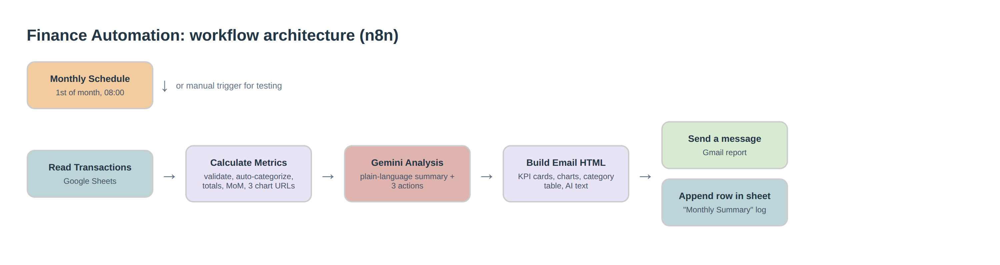
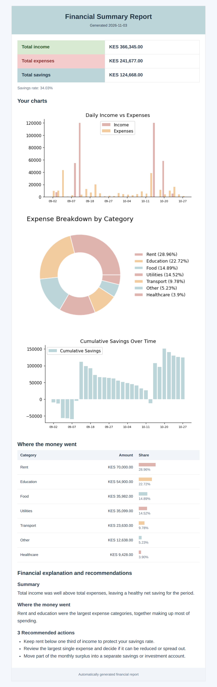

# Finance Automation: Automated Monthly Financial Reports with n8n + Gemini AI

> Turn a messy Google Sheet of transactions into a clean, AI-explained financial report in your inbox, automatically, every month.



## The problem

Small business owners, freelancers and households track money in spreadsheets, but nobody has time to total it up, spot where the money went, and work out what to do next. Reports get skipped, and problems are noticed late.

## The solution

An [n8n](https://n8n.io) workflow that runs on a schedule and:

1. **Reads** your transactions from Google Sheets
2. **Cleans and validates** every row (bad amounts, bad dates and unknown types are caught, not silently counted)
3. **Auto-categorizes** rows that have no category (rent, salaries, food, transport, utilities, education, healthcare, sales, investment income)
4. **Calculates** income, expenses, net savings, savings rate, expense breakdown, biggest expense and month-over-month change
5. **Asks Gemini AI** for a short plain-language summary and 3 practical actions, using *only* your numbers (the prompt forbids inventing figures)
6. **Emails** a formatted HTML report with KPI cards, 3 charts and a category table
7. **Logs** each run as a new row in a "Monthly Summary" sheet, so you build a history over time

## What the report looks like

*Generated by running this repo's own workflow code on the sample data in [`sample-data/`](sample-data/transactions_sample.csv).*

<p align="center">
  
</p>

## Features

| | |
|---|---|
| **Scheduled or manual** | Runs on the 1st of each month at 08:00, or click *Execute workflow* to test |
| **Data validation** | Rows with invalid amount, type or date are excluded and listed in the node output |
| **Auto-categorization** | Keyword rules fill in missing categories; unmatched rows go to "Other" |
| **Currency-tolerant** | Amounts like `KES 1,200` are cleaned to numbers (default currency: KES, easy to change) |
| **Guarded AI** | Gemini only sees computed totals, with strict instructions not to invent data, under ~180 words |
| **Email-safe HTML** | Table-based layout that renders in Gmail, Outlook and mobile; all text is HTML-escaped |
| **Audit trail** | Every run appends totals, top category and transaction count to a summary sheet |

## Tech stack

n8n · Google Sheets API · Gemini API · Gmail API · QuickChart (chart images) · JavaScript

## Getting started

### 1. Prepare your Google Sheet

Create a spreadsheet with two tabs.

**Tab `transactions_large`** with these columns (see [`sample-data/transactions_sample.csv`](sample-data/transactions_sample.csv)):

| Date | Description | Category | Type | Amount (KES) |
|---|---|---|---|---|
| 2026-09-03 | Monthly rent | | expense | 35000 |
| 2026-09-05 | Client payment | Sales | income | 60000 |

- `Type` must be `income` or `expense`
- `Category` can be left blank and will be auto-filled from the description

**Tab `Monthly Summary`** with these headers (the log is written here):
`Month`, `Total Income (KES)`, `Total Expenses (KES)`, `Net Savings (KES)`, `Savings Rate (%)`, `Top Expense Category`, `Transactions`, `Report Sent`

### 2. Import the workflow

1. In n8n choose **Workflows → Import from file** and select [`workflow/finance-automation.json`](workflow/finance-automation.json)
2. Create credentials and attach them to the nodes:
   - **Google Sheets OAuth2** → *Read Transactions*, *Append row in sheet*
   - **Google Gemini (PaLM) API** → *Gemini Analysis*
   - **Gmail OAuth2** → *Send a message*
3. Replace the placeholders:
   - `YOUR_GOOGLE_SHEET_ID` in both Google Sheets nodes (pick your sheet from the list)
   - `YOUR_EMAIL@example.com` in *Send a message*
4. In *Gemini Analysis*, confirm the model name in the URL is one your API key can use (for example `gemini-2.5-flash`)

### 3. Test, then activate

Click **Execute workflow**, check your inbox, then toggle the workflow **Active** so the monthly schedule runs.

### Preview the report without n8n

```bash
node scripts/preview.js
```

Runs the workflow's two Code nodes locally against the sample CSV and prints the validation result (50 valid rows, 1 deliberately broken row caught). It needs only Node.js.

## Customization

- **Currency:** change `Amount (KES)` and the `money()` formatter in *Build Email HTML*
- **Categories:** edit the `rules` list in *Calculate Metrics*
- **Schedule:** change the interval in *Monthly Schedule* (weekly, daily, etc.)
- **Report style:** colors and layout live in *Build Email HTML*
- **AI tone and language:** edit the `aiPrompt` text in *Calculate Metrics*
- **Recipients:** add more addresses in *Send a message*, or swap Gmail for Outlook, SMTP or Slack

## Repository structure

```
.
├── workflow/finance-automation.json   # n8n workflow (credentials and IDs removed)
├── sample-data/transactions_sample.csv
├── scripts/preview.js                 # local test of the calculation + email nodes
├── docs/images/                       # architecture diagram and report preview
├── LICENSE
└── README.md
```

## Known limitations

- Rows that fail validation are reported in the *Calculate Metrics* output but are not yet listed in the email
- Chart images are generated by the public QuickChart service, so they need internet access when the email is opened
- Month-over-month figures are passed to the AI summary but not shown as their own section in the email
- AI recommendations are generated from totals only and are **not financial advice**

## Security

No credentials, API keys or personal data are stored in this repo. Credentials are configured inside your own n8n instance.

## Need this built for your business?

I build custom n8n automations: reports, invoicing, alerts, CRM and spreadsheet workflows. Contact: *add your Fiverr / email link here*

## License

MIT, see [LICENSE](LICENSE).
